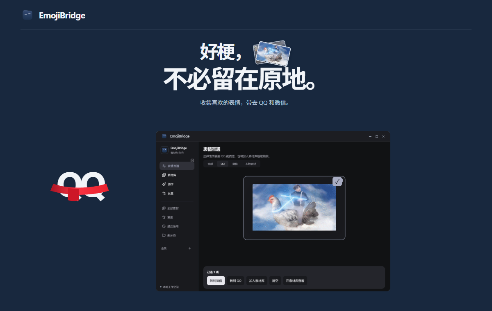
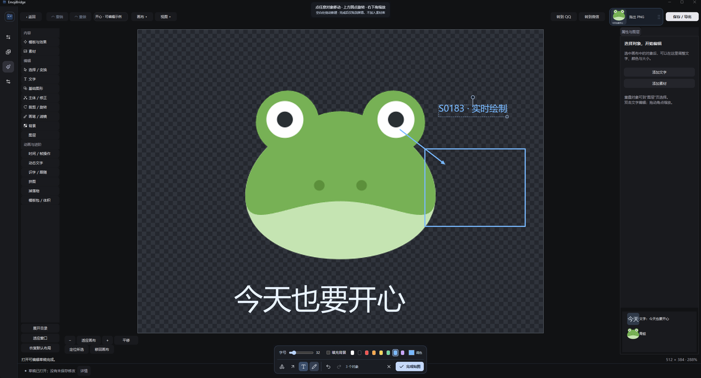
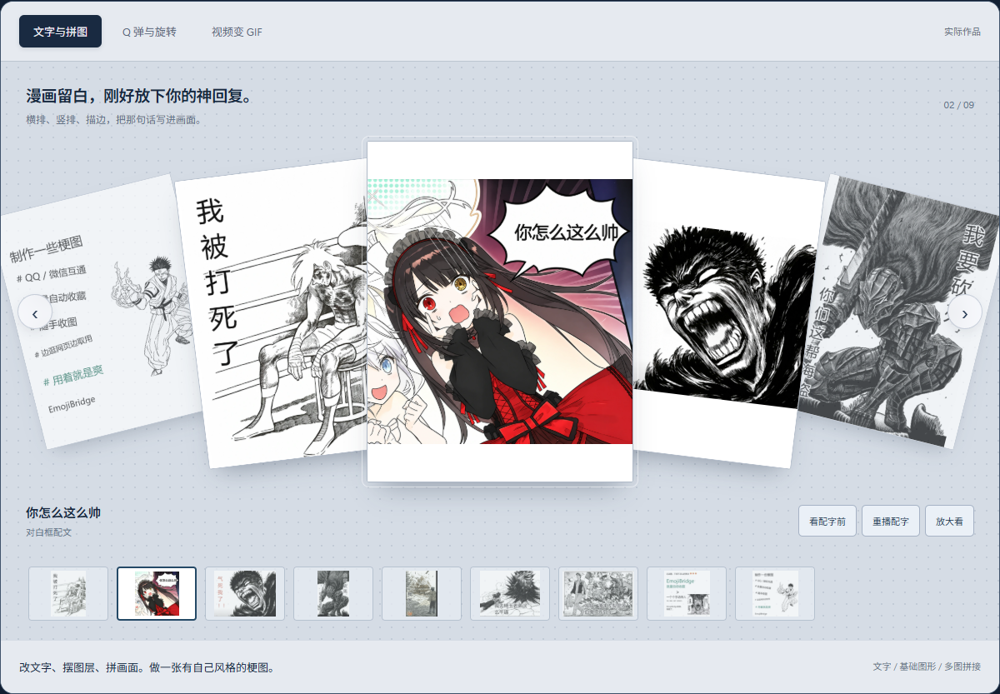

# EmojiBridge

**收集表情，创作 GIF，把灵感贴到桌面。**

一款免费的 Windows 桌面素材与 Meme 创作工具：收集整理、视频转 GIF、图文编辑、随手素材、桌面贴图与实时绘制。QQ / 微信互通作为附加能力保留。

[选择下载](#下载与开始使用) · [功能详览](https://neo-sunxiaochuan.github.io/EmojiBridge/features.html) · [完整宣传片](https://neo-sunxiaochuan.github.io/EmojiBridge/docs/VIDEO.html) · [同款表情包](https://neo-sunxiaochuan.github.io/EmojiBridge/docs/MATERIALS.html) · [使用条件](https://neo-sunxiaochuan.github.io/EmojiBridge/docs/COMPATIBILITY.html)

[**☆ Star 支持项目**](https://github.com/NEO-SUNXIAOCHUAN/EmojiBridge) · **Created by Neo**

## 在桌面上，直接画出来

从随手素材拖出图片或 GIF，贴到屏幕上。开启实时绘制，画圈、拉箭头、输入文字；已有对象可以重新选中、移动、旋转和缩放。绘制期间桌面与 GIF 继续动态播放，完成后得到临时贴图，想收藏时再手动加入素材库。

## 漫画配文与图文创作

漫画加一句神回复，多张图片拼出一个新梗。文字、基础图形、静态图与 GIF 可以一起组成画面；也可以套用模板、复用排版。

[打开交互画廊](https://neo-sunxiaochuan.github.io/EmojiBridge/index.html#create)：七组漫画配文，加上标签图与论战图。同一展示区也能切换到“评论区收集”，查看从抖音评论区拖入随手素材的过程。选择作品，查看配字前后，或展开大图读清每一句。

想知道具体能做什么？[功能详览](https://neo-sunxiaochuan.github.io/EmojiBridge/features.html)按收集、裁剪 GIF、抠主体、拼图、文字图形与模板、趣味动效、随手素材、导出互通八个方向展开，每组都有对应演示片段。

<b>让表情更有戏：Q 弹、旋转、掉落物与传送</b>

调整动效参数，再导出自己的版本。视频可以选取片段、裁剪画面，转成聊天里能循环播放的 GIF。

## 做好了，顺手拖出去

从成品拖出区，把刚做好的图片或 GIF 拖到支持接收文件的聊天窗口或文件夹，减少保存后再翻找的步骤。[体验拖出示意](https://neo-sunxiaochuan.github.io/EmojiBridge/index.html#drag-out)。

经验瓶在处理完成后收起经验球，末影人陪表情走过搬运舞台。两套软件同款动效，也可以在[宣传页亲手播放](https://neo-sunxiaochuan.github.io/EmojiBridge/index.html#product-details)。

## 逛到哪，带到哪

随手素材浮在网页上方。喜欢的收进来，想用的拖出去；也可以贴在屏幕上，继续拖动、缩放。它是独立置顶窗口，不改变网页内容。

做好后，从成品拖出区域拖到支持接收文件的窗口，或加入 QQ / 微信收藏。

## 需要时，再带到 QQ 和微信

选中一组表情，交给 EmojiBridge 转移。QQ 和微信可以双向互通；素材库里的图片、GIF，以及编辑完成的作品，也能加入收藏。

这是功能流程的视觉示意。自动操作客户端时需要本机登录，并保持窗口可操作；QQ 本人缓存读取可在 QQ 关闭时进行；微信通过本人的文件传输助手发送并添加表情，会占用文件传输助手的聊天上下文并产生消息记录；QQ通过本地导入收藏。支持范围见[兼容说明](https://neo-sunxiaochuan.github.io/EmojiBridge/docs/COMPATIBILITY.html)。

## 下载与开始使用

**S0183 · 三版任选一个 → 全部解压 → 双击 EB/EmojiBridge.exe。无需安装 Python。**

| 下载 | 怎么选 |
| --- | --- |
| [轻量版 ZIP · 523.40 MB（推荐）](https://github.com/NEO-SUNXIAOCHUAN/EmojiBridge/releases/download/S0183/EmojiBridge-S0183-Windows-x64-lite.zip) | 自带默认自动抠图、基础编辑、视频/GIF、OCR 与互通组件；更多模型和模板按需选装 |
| [带模板版 ZIP · 859.56 MB](https://github.com/NEO-SUNXIAOCHUAN/EmojiBridge/releases/download/S0183/EmojiBridge-S0183-Windows-x64-lite-templates.zip) | 包含轻量版全部功能与表情工厂模板，无需另装模板包 |
| [完整离线版 ZIP · 1.35 GB](https://github.com/NEO-SUNXIAOCHUAN/EmojiBridge/releases/download/S0183/EmojiBridge-S0183-Windows-x64-full.zip) | 包含带模板版全部内容，再含动漫/精细抠图和 tiny 字幕 |
| [公开源码 · 114.80 MB](https://github.com/NEO-SUNXIAOCHUAN/EmojiBridge/releases/download/S0183/EmojiBridge-S0183-public-source.zip) · [SHA256 校验](https://github.com/NEO-SUNXIAOCHUAN/EmojiBridge/releases/download/S0183/SHA256SUMS.txt) | 开发者或需要核验下载内容的用户 |
| [宣传片同款素材 · 707 MB](https://github.com/NEO-SUNXIAOCHUAN/EmojiBridge/releases/download/S0163/EmojiBridge-promo-assets-20261114.zip) | 独立可选，解压后多选导入，不随软件自动初始化 |

三版都自带默认 **自动／U²-Net** 模型，默认抠主体无需下载。轻量版可通过“设置 → 可选组件”添加模型与模板；已有 S0174 组件可继续使用。缺少系统 WebView2 时，按启动提示安装微软官方组件。

**S0175 用户需手动安装 S0183 一次，之后才能使用内置更新。** 保存作品并退出旧程序，完整解压到较短的新目录（例如 `D:/EmojiBridge`），运行 `EB/EmojiBridge.exe`；保留旧目录与个人素材、账号和草稿。不要混合覆盖或叠加旧补丁。使用自定义 `--data-dir` 的用户继续使用原数据目录参数。

新版启动只检查官方稳定版信息；点击更新后才下载同类型完整 ZIP，并核对大小、SHA256 和文件清单，正常保存退出后替换程序、重启确认，失败时尝试回退。它不是差分更新；上传源码本身不会触发更新，需要发布配套软件包和更新清单。兼容的已安装组件会保留。

S0183 汇总 S0176–S0183 的改进：素材库批量选择、文件夹导入与父子合集、相似图人工整理、备份恢复；随手素材复制与桌面贴图；实时桌面绘制中的形状、箭头、文字与画笔，可选回对象移动、旋转、缩放。完成绘制后生成临时贴图，不自动入库。QQ 来源按“更新”读取本人缓存，读取和复制不再自动加入素材库。

[安装、选装组件与完整升级说明](https://neo-sunxiaochuan.github.io/EmojiBridge/docs/DOWNLOADS.html)

第一次使用，从哪里开始？

先把几张自己的图片拖入素材库，试试编辑、保存和拖出。使用互通前，登录自己的 QQ、微信，按界面引导连接账号。QQ 可直接读取本人的缓存目录，点击“更新”后刷新；自动操作客户端进行互通时，请勿遮挡、点击或切换目标窗口。

## 使用前的小提醒

- **转入微信会使用文件传输助手**，占用其聊天上下文并产生相应消息记录。
- **自动操作客户端进行互通时，请勿遮挡、点击或切换目标窗口**，等待任务完成后再操作。

## 支持 EmojiBridge

如果它帮你把好梗带到了想去的地方，欢迎 [点个 Star](https://github.com/NEO-SUNXIAOCHUAN/EmojiBridge)，支持 Neo 继续打磨。也欢迎带着具体使用场景来提建议。

## 作者与许可

Created by **Neo**。项目自有源码采用 **GPL-3.0-only**；第三方代码及素材保留各自许可与来源，表情包、音乐、漫画等不自动适用源码许可。

**EmojiBridge 由 Neo 创建与维护。** 项目名称与专用 Logo 用于标识原项目，品牌权益与源码许可分别说明；衍生版应与官方发行版清楚区分。详见[作者、品牌与衍生项目署名说明](BRANDING.md)。

## 从源码运行与构建

Windows x64、带 Tk 的 Python 3.12 与 Microsoft WebView2。桌面入口还需要 `runtime/desktop` 中的桌面依赖；完整构建的组件准备与固定校验值见 [BUILDING.md](BUILDING.md)。公开源码与本版完整包对应，产品提交记录在 [SOURCE_BUILD.json](SOURCE_BUILD.json)。

详见 [功能说明](FEATURES.md)、[第三方声明](THIRD_PARTY_NOTICES.md)及[资源核对记录](RELEASE_RIGHTS.md)。
