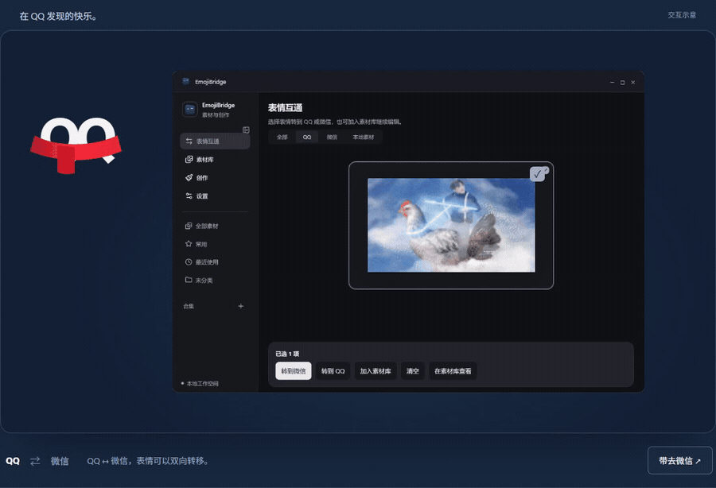
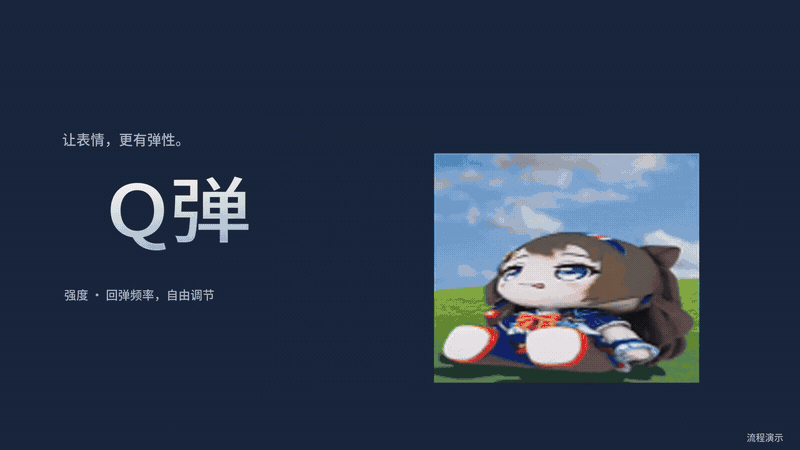
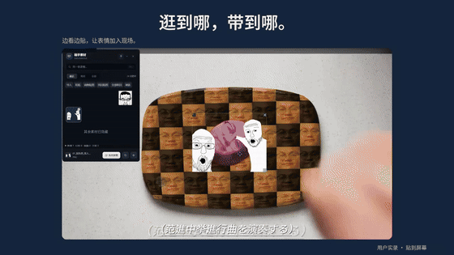

# EmojiBridge

**把喜欢的表情收起来，改成自己的梗，再带到 QQ 和微信。**

一款 Windows 桌面表情工具，连接收集、编辑和使用。QQ ↔ 微信互通、随手素材、视频转 GIF、图文拼接与动效编辑，都在同一个工作空间里。

[选择下载](#下载与开始使用) · [功能详览](https://neo-sunxiaochuan.github.io/EmojiBridge/features.html) · [完整宣传片](https://neo-sunxiaochuan.github.io/EmojiBridge/docs/VIDEO.html) · [同款表情包](https://neo-sunxiaochuan.github.io/EmojiBridge/docs/MATERIALS.html) · [使用条件](https://neo-sunxiaochuan.github.io/EmojiBridge/docs/COMPATIBILITY.html)

[**☆ Star 支持项目**](https://github.com/NEO-SUNXIAOCHUAN/EmojiBridge) · **Created by Neo**

## 好梗，不必留在原地

选中一组表情，交给 EmojiBridge 转移。QQ 和微信可以双向互通；素材库里的图片、GIF，以及编辑完成的作品，也能加入收藏。

这是功能流程的视觉示意。实际运行需要本机登录客户端，并保持窗口可操作；微信通过本人的文件传输助手发送并添加表情，会占用文件传输助手的聊天上下文并产生消息记录；QQ通过本地导入收藏。支持范围见[兼容说明](https://neo-sunxiaochuan.github.io/EmojiBridge/docs/COMPATIBILITY.html)。

## 漫画配文与图文创作

漫画加一句神回复，多张图片拼出一个新梗。文字、基础图形、静态图与 GIF 可以一起组成画面；也可以套用模板、复用排版。

[打开交互画廊](https://neo-sunxiaochuan.github.io/EmojiBridge/index.html#create)：七组漫画配文，加上标签图与论战图。同一展示区也能切换到“评论区收集”，查看从抖音评论区拖入随手素材的过程。选择作品，查看配字前后，或展开大图读清每一句。

想知道具体能做什么？[功能详览](https://neo-sunxiaochuan.github.io/EmojiBridge/features.html)按收集、裁剪 GIF、抠主体、拼图、文字图形与模板、趣味动效、随手素材、导出互通八个方向展开，每组都有对应演示片段。

<b>让表情更有戏：Q 弹、旋转、掉落物与传送</b>

调整动效参数，再导出自己的版本。视频可以选取片段、裁剪画面，转成聊天里能循环播放的 GIF。

## 做好了，顺手拖出去

从成品拖出区，把刚做好的图片或 GIF 拖到支持接收文件的聊天窗口或文件夹，减少保存后再翻找的步骤。[体验拖出示意](https://neo-sunxiaochuan.github.io/EmojiBridge/index.html#drag-out)。

经验瓶在处理完成后收起经验球，末影人陪表情走过搬运舞台。两套软件同款动效，也可以在[宣传页亲手播放](https://neo-sunxiaochuan.github.io/EmojiBridge/index.html#product-details)。

## 逛到哪，带到哪

随手素材浮在网页上方。喜欢的收进来，想用的拖出去；也可以贴在屏幕上，继续拖动、缩放。它是独立置顶窗口，不改变网页内容。

做好后，从成品拖出区域拖到支持接收文件的窗口，或加入 QQ / 微信收藏。

## 下载与开始使用

**下载 ZIP → 全部解压 → 双击 EmojiBridge.exe。** 普通用户不需要运行命令行或编译源码。

| 下载项 | 怎么选 |
| --- | --- |
| Windows x64 主程序 | 先用互通、素材库与编辑功能，按需准备组件 |
| 完整包（含模板扩展） | 希望模板扩展一起下载；与主程序二选一 |
| 模板扩展 | 已有主程序，下载发行说明中注明兼容的扩展 |
| 宣传片同款表情包 | 独立可选素材，解压后多选导入 |

[前往 GitHub Releases 选择软件包](https://github.com/NEO-SUNXIAOCHUAN/EmojiBridge/releases/latest)。抠主体模型和视频处理组件按需准备；不会为了同款素材而强制下载整套宣传片资源。

[下载说明](https://neo-sunxiaochuan.github.io/EmojiBridge/docs/DOWNLOADS.html) · [素材导入方法](https://neo-sunxiaochuan.github.io/EmojiBridge/docs/MATERIALS.html) · [兼容与使用条件](https://neo-sunxiaochuan.github.io/EmojiBridge/docs/COMPATIBILITY.html)

第一次使用，从哪里开始？

先把几张自己的图片拖入素材库，试试编辑、保存和拖出。使用互通前，登录自己的 QQ、微信，按界面引导连接账号。读取 QQ 表情或执行互通时，不要移动鼠标、点击或切换窗口；等待任务完成后再操作。

## 使用前的小提醒

- **转入微信会使用文件传输助手**，占用其聊天上下文并产生相应消息记录。
- **读取 QQ 表情及执行互通时不要移动鼠标、点击或切换窗口**，等待任务完成后再操作。

## 支持 EmojiBridge

如果它帮你把好梗带到了想去的地方，欢迎 [点个 Star](https://github.com/NEO-SUNXIAOCHUAN/EmojiBridge)，支持 Neo 继续打磨。也欢迎带着具体使用场景来提建议。

## 作者与许可

Created by **Neo**。项目自有源码采用 **GPL-3.0-only**；第三方代码及素材保留各自许可与来源，表情包、音乐、漫画等不自动适用源码许可。

## 从源码运行与构建

Windows x64、Python 3.12（包含 Tk）、.NET Framework 4.x / WebView2。
使用独立虚拟环境：`py -3.12 -m venv .venv`，然后
`.venv\Scripts\python.exe -m pip install -r requirements-release.txt`。
双击 `run-desktop.cmd` 或运行 `python -X utf8 scripts/desktop_modern.py`。
前端源代码在 desktop-ui，按 pnpm-lock.yaml 安装固定依赖后执行 `pnpm build`。

构建：`python scripts/build_pilot.py --output exports/windows-preview --runtime <Python根目录> --desktop-runtime <宿主依赖目录>`。
可选参数：`--cutout-runtime`、`--vision-runtime`、`--template-runtime`；各目录对应预先安装的锁定依赖。
模板/OCR 的准确依赖、模型/资源 SHA 在 third_party/factory 的两个 runtime-lock.json。
组件准备由 `src/emoji_bridge/capabilities.py` 管理，
不要把个人缓存、库或旧 BUILD.json 当成源代码。构建使用 Git 已跟踪文件，先提交本地修改；
公开源码 ZIP 不含开发历史，解压后可 `git init`，检查文件后本地提交再构建。

针对初始化升级的检查：设置 PYTHONPATH=src;scripts;tests 后运行
`python -m unittest test_builtin_upgrade_S0162 -v`。测试只使用临时库。

详见 [功能说明](FEATURES.md)、[第三方声明](THIRD_PARTY_NOTICES.md)及[资源核对记录](RELEASE_RIGHTS.md)。
